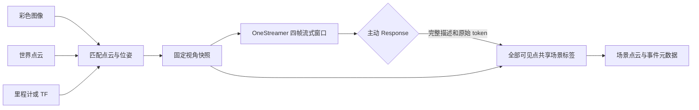

# 主动流式场景描述与点云标注

OneStreamer 持续观察图像，仅在模型输出 `</Response>` 时产生标注。
该次回答的完整文字作为场景标签，赋给触发画面中全部可见点；原始模型 token ID 序列一并保存。
例如回答 “A laptop and a water bottle are visible.”，整个可见点云都关联这一句话。
这是视角的场景上下文，每个点不代表句子中的某一个物体。



## 模型配置

默认复用 `/home/crl/DDD/EGI/robot-agent` 中的
`modules/OneStreamer/robot_integration/live_config.json`，应用
`configs/onestreamer-fast.json` 覆盖项。模型 Python 和权重从该仓库或其上一级 EGI 目录解析，
可用 `worker_python`、`model_path` 显式覆盖。不修改参考仓库源码。

`gpu_worker.py` 导入参考 `live_worker.py`，直接返回其流式结果。
NF4、SDPA、视觉缓存、四帧窗口、50176 最大图像像素、temperature=0 和 8fps 采样沿用参考配置。
为了容纳场景描述，本仓库通过 `description_max_new_tokens: 128` 覆盖 fast 配置的 8-token 上限。
每个窗口只有一次流式推理，触发后直接使用原回答。

ROS 使用系统 Python 3.12，worker 使用现有 Python 3.10 环境，通过持久 Unix socket
保存流式会话。启动 worker 时清除继承的 `PYTHONPATH` / `PYTHONHOME`，避免跨版本模块混用。
默认 socket 为 `/tmp/vln-onestreamer-<uid>/worker.sock`；已存在时拒绝重复启动。
复用已有专用 worker 时设置 `start_onestreamer_worker:=false` 并配置 `socket_path`。
参考 worker 一次服务一个连接，不能与 robot-agent 客户端同时占用。

## 输入和时间

| 参数 | 默认话题 | 类型 |
| --- | --- | --- |
| `color_topic` | `/camera/color/image_raw` | Image |
| `cloud_topic` | `/cloud_registered` | PointCloud2，FLOAT32 XYZ |
| `camera_info_topic` | `/camera/color/camera_info` | CameraInfo |
| `odom_topic` | `/Odometry` | Odometry |

为采样图像选择最近的点云和里程计，默认容差 150ms。缺少匹配数据或可见点时跳过。
四个有效采样帧组成一个流式窗口；实时节点推理期间跳过新图像，避免积压。
此同步方法不包含运动点云的逐点去畸变。

模型回答绑定窗口最后一帧的固定快照，验证首尾时间戳和问题后才接受。
推理延迟不会使旧回答贴到新画面上。任务切换或源时间回退会更新会话版本，丢弃旧版本在途回答。

## 保留原 VLN 标定

默认 `transform_mode: odometry`，内外参与 ROS 1 VLN 分支原实现一致：

```text
fx = fy = 385.45, cx = 320, cy = 240, image = 640 × 480
R_camera_to_body = [[0, 0, 1],
                    [1, 0, 0],
                    [0, 1, 0]]
t_camera_to_body = [0, 0, 0]
```

原来的相机点到世界点关系是：

```text
p_world = R_odom · (R_camera_to_body · p_camera + t_camera_to_body) + t_odom
```

当前将世界点投影到画面，使用上述关系的逆变换：

```text
p_camera = R_camera_to_bodyᵀ · (R_odomᵀ · (p_world - t_odom) - t_camera_to_body)
```

点云和里程计须位于同一 `frame_id`，输出 XYZ 始终保留世界坐标。
单元测试用带旋转和平移的位姿检验该逆变换，避免轴序、转置或符号改变。

收到匹配分辨率和 optical frame 的 CameraInfo 时优先使用其真实内参，支持
plumb_bob、rational_polynomial、equidistant；`image_rectified=true` 使用 R/P 校正参数，
不支持带基线项的立体 P。无 CameraInfo 时使用上述原 VLN 内参，并假设零畸变。
本地 bag 没有 CameraInfo，因而沿用原配置。
可显式选择 `transform_mode: tf`，按图像时间查询 world 到 optical frame 的变换；查询失败时跳过。

## 每段描述的观察视角

每次触发保存 `viewpoint`，对应实际贴标签的窗口最后一帧；`window_viewpoints` 按时间顺序
保存本次送给模型的所有输入帧视角。两者在捕获图像时固定，推理完成后不读取最新位姿替代。

- `position`：相机在 `frame_id` 世界坐标系中的位置，单位米。
- `orientation_xyzw`：四元数，表示投影相机坐标系到世界坐标系的旋转。
- `forward` / `up`：世界坐标中的观察方向和画面向上方向，均为单位向量。
- `stamp_ns` / `source_pose_ns`：图像时间和匹配里程计时间；TF 模式在图像时间查询，后者为 null。
- `camera_model`：图像宽高、投影内参、畸变参数和是否已校正。
- `transform_source` / `image_frame_id`：变换来源及图像坐标系名称。

相机位置包含相机到机体的平移外参，朝向包含机体姿态和相机安装旋转。
投影相机轴为 X 向右、Y 向下、Z 向前；已校正图像的姿态还组合 CameraInfo.R 的逆旋转，
与实际投影使用的坐标一致。里程计模式仍采用容差内的最近位姿，不把它当成精确插值位姿。
`centroid` 保留的是可见点云中值中心，用于显示描述文字，与相机位置分别记录。

## 标签与可见范围

持续任务由 `task` 指定，可向 `/semantic/task` 发布字符串更新。
默认询问当前图像可见内容，并要求首次清晰观察、新内容或场景变化时响应。
是否触发由模型决定；Silence / Standby 只记录状态。
提示词会影响触发行为，本地实跑中泛化的场景提示曾导致整包 Silence，默认保留已验证能响应的问法。

投影剔除非有限点、相机后方、视锥外和 near_clip/far_clip 外的点。
每个默认 2 像素格内保留距最近表面不超过 0.1m 的点；保留点全部赋同一完整场景描述。
不按描述中的物体拆分区域。

`label_id` 对应完整描述，相同原文共享 ID；`event_id` 标识本次触发，关联这次生成的原始
`token_ids`、`token_text` 和 `token_source`。不重新分词，也不改写模型回答。
接收时检查回答与原始 Response、token payload 一致，缺少原始 token 的结果拒绝标注。

| 输出话题 | 内容 |
| --- | --- |
| `/semantic/cloud` | x/y/z FLOAT32，rgb/label_id/event_id UINT32 |
| `/semantic/labels` | 事件 ID、完整描述、原始 token、标签字典、相机位姿、输入窗口视角、源时间戳 |
| `/semantic/projection` | 当前触发画面的所有可见点按场景着色 |
| `/semantic/markers` | RViz 中显示该次场景描述，位置为整片可见点云的中值中心 |
| `/semantic/state` | 原始模型状态、token、响应、窗口时间、耗时、拒绝原因 |

场景中心不表示某个物体的位置，因此感知节点不发布 ObjectCoordinates。
启动配置默认关闭目标选择；外部物体坐标仍可供原导航接口使用。

## 检查

单元测试覆盖原 VLN 变换、视锥/遮挡、完整场景标签、原始 token 保留、参考配置和持久连接。
ROS 集成测试覆盖真实 DDS/socket、主动响应、无响应、快照一致性、任务更新、TF、时钟回退，
以及外部物体坐标到 A* 规划。实际模型描述可能存在视觉误认，原始输出保留供核验。
