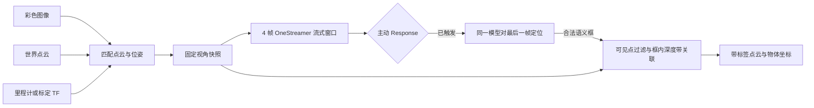

# 主动流式理解与投影点云语义标注

本实现替换连续目标检测与深度图反投影：OneStreamer 持续观察图像，当模型以
`</Response>` 确认事件时，使用同一已加载模型对该帧单独定位，再将合法物体类别与语义框
关联到对应视角下的可见点云。
Silence / Standby 不产生标注。没有有效框的文字答案会记录到状态话题，不会被猜测成点标签。



## 复用 robot-agent

默认 `robot_agent_root` 为 `/home/crl/DDD/EGI/robot-agent`。
读取该目录中的 `modules/OneStreamer/robot_integration/live_config.json`，再应用
`configs/onestreamer-fast.json` 的覆盖项。模型 Python 和权重优先在该目录寻找，
其次在它的上一级 EGI 目录寻找，可用 `worker_python` 和 `model_path` 显式覆盖。
不读取 `.env`，不复制模型，不启动参考仓库的摄像头和 ROS 桥接，也不修改其源码。

本仓库的 `gpu_worker.py` 导入参考 `live_worker.py`，复用其服务端、流式处理器、NF4、SDPA 和视觉缓存。
4 帧窗口、50176 最大图像像素、temperature=0、8fps 采样和 8-token 主动响应均保留 fast 配置。
主动问题中不掺入定位格式要求；仅在 Response 后，使用同一 engine 对捕获的最后一帧执行
独立的定位指令，默认预算 `grounding_max_new_tokens=256`。不加载第二套权重，也不将定位
对话写入流式事件历史。复杂定位输出若被截断会被拒绝，可按延迟和显存预算调整定位 token 上限。

ROS 使用系统 Python 3.12，worker 使用现有 Python 3.10 环境；通过持久 Unix socket
连接保持流式会话，移除 worker 子进程继承的 ROS `PYTHONPATH`，避免跨版本模块混用。
启动器仅管理本次创建的 worker，退出时释放客户端和该 worker。

默认 socket 为 `/tmp/vln-onestreamer-<uid>/worker.sock`。已有同名 socket 时拒绝启动另一个 worker，
不会自动删除它。连接已运行的本仓库语义 worker 适配器时设置 `start_onestreamer_worker:=false` 和对应
`socket_path`。参考 worker 一次服务一个连接，不能同时与 robot-agent 客户端争用同一实例。

## 输入与时序

- `color_topic`：`sensor_msgs/msg/Image`，默认 `/camera/color/image_raw`。
- `cloud_topic`：`sensor_msgs/msg/PointCloud2`，默认 `/cloud_registered`，XYZ 为 FLOAT32。
- `camera_info_topic`：`sensor_msgs/msg/CameraInfo`，默认 `/camera/color/camera_info`。
- `odom_topic`：`nav_msgs/msg/Odometry`，默认 `/Odometry`。

为每个采样图像，在有界缓存中选择时间最近的点云和里程计，时间差不得超过
`sync_tolerance`，默认 150ms。此近邻匹配不对运动中的点云逐点去畸变。
匹配数据缺失或没有可见点时跳过该帧；4 个有效采样帧组成一次请求。
推理期间跳过新图像，避免未处理窗口积压，但持续记录最新时间与传感器数据。

输出严格对应窗口最后一帧的固定快照，验证 worker 的首尾时间戳和问题内容后才接收结果。
即使推理完成时机器人已移动，也不会将旧语义框贴到新的点云上。
任务切换和录包时钟回退会改变会话版本，并丢弃旧版本的在途响应。
重复时间戳不再采样。每个实例只保存有界传感器缓存、待发送窗口及在途快照。

## 相机与坐标

点云必须位于配置的 `frame_id`。输出 XYZ 保持该世界坐标系。
标定内参优先来自与图像同分辨率、同 optical frame 的 CameraInfo，支持
`plumb_bob`、`rational_polynomial`、`equidistant` 投影。
`image_rectified=true` 应用 CameraInfo.R 的校正旋转，使用 P 的相机矩阵并忽略畸变，
适用于已校正的单目图像；不支持 P 中带非零基线项的立体相机。
没有 CameraInfo 时使用 fx/fy/cx/cy，要求图像分辨率与 image_width/image_height 一致；
此时假定畸变为零。示例内参不是标定结果的替代品。

`transform_mode` 有两种取值：

- `tf`：以图像时间戳查询 `cloud.header.frame_id → image.header.frame_id`，目标必须是光学坐标系，
  即 Z 向前、X 向右、Y 向下。查不到变换时跳过，不采用最新时刻变换代替。
- `odometry`：点云与里程计位于相同世界坐标系，使用
  `p_world = R_odom * (R_camera_to_body * p_camera + t_camera_to_body) + t_odom` 的逆变换。
  相机外参必须对应里程计的机体坐标系。

默认 odometry 模式保留已有轴约定，适配本地录包的 world/body 数据。
录包没有 CameraInfo，也没有 body 到相机的 TF；实际标注位置的准确度取决于补齐的真实标定。
不再订阅深度图，也不需要将未对齐的原始深度话题伪装成 aligned depth。

## 触发与输出

持续任务由 `task` 指定，可向 `/semantic/task` 发布字符串替换，例如：

```bash
ros2 topic pub --once /semantic/task std_msgs/msg/String "{data: 'Report when a person enters the camera view.'}"
```

主动任务保持纯事件问题。触发后对固定最后一帧使用独立定位约定：`{"objects":[{"label":"chair","bbox":[100,200,500,900]}]}`。
框是最后一帧相对于整张图像的 0–1000 归一化坐标，最多接收 32 个区域。
无效 JSON、非有限数、空类别、越界框、反向框和不匹配的源窗口均拒绝标注。
模型可选择一直保持 Silence；程序不会用固定周期或伪造响应替代主动触发。
`/semantic/state` 的 `raw`、`tokens`、`trigger_response` 保留主动输出，`response` 为后续定位文本，
`grounding_ms` 与 `grounding_tokens` 记录独立定位耗时和 token；两阶段均绑定原窗口时间戳。

投影先剔除相机后方、视锥外、无效和超出 near_clip/far_clip 的点。
每个 visibility_cell_size 像素格保留距最前表面不超过 occlusion_tolerance 的点。
对每个语义框，以中心区域点的中值深度为参考，仅标记 foreground_depth_band 内的点，
中心无点时退回整个框。重叠框优先较小框，区域少于 min_region_points 个点时不输出物体。

这是基于框和深度的弱标注，不能保证边界精确，也不能消除所有前景/背景混淆。
没有语义匹配的可见点使用 label_id=0。不输出视锥外或遮挡后的点。
不进行全局语义地图融合、跨帧实例跟踪或实例掩码分割。

| 输出话题 | 内容 |
| --- | --- |
| `/semantic/cloud` | PointCloud2：x/y/z FLOAT32，rgb/label_id/instance_id UINT32 |
| `/semantic/labels` | JSON：标签字典、每个区域、点数、中值坐标、图像/点云/位姿时间戳 |
| `/semantic/projection` | 图像：投影点、语义颜色和区域框 |
| `/semantic/state` | JSON：模型原始状态、响应、窗口时间、推理耗时和拒绝原因 |
| `/object/absolute_coords_list` | ObjectCoordinates：本次有效语义区域的世界坐标中值中心 |
| `/object/markers` | MarkerArray：本次有效区域的标签；清除上次标签 |

label_id 在节点生命周期内按类别分配；instance_id 只在当前事件内有效。
点云采用固定 XYZ/语义布局；原始点云其他字段仍保留在原输入话题中。
输出 header 使用触发图像时间戳，JSON 额外记录匹配的点云和位姿时间，便于审计。
导航端继续使用现有 ObjectCoordinates 消息，不依赖旧检测框消息。

## 自动化检查

单元测试验证标定旋转、视锥和遮挡、框深度带关联、响应格式、参考配置解析和持久连接。
ROS 集成测试通过真实 DDS 和 Unix socket 验证触发、无响应、延迟、错误时间戳、任务更新、
TF、时钟回退及语义坐标到 A* 规划。可控 worker 只替代模型推理，不替代 ROS 或投影逻辑。
实际 GPU worker 是否触发、定位质量与标定准确度需使用本机模型和数据单独检查。
